# GNOME Launcher

A customizable GNOME Shell app launcher with **15 layouts**, keyboard-driven navigation, native GNOME app search, and Matugen-compatible theming.

Built with GNOME Shell's native `ModalDialog`, it works on stock GNOME under Wayland and X11.

## Screenshots

All 15 layouts:

| | | |
|---|---|---|
| 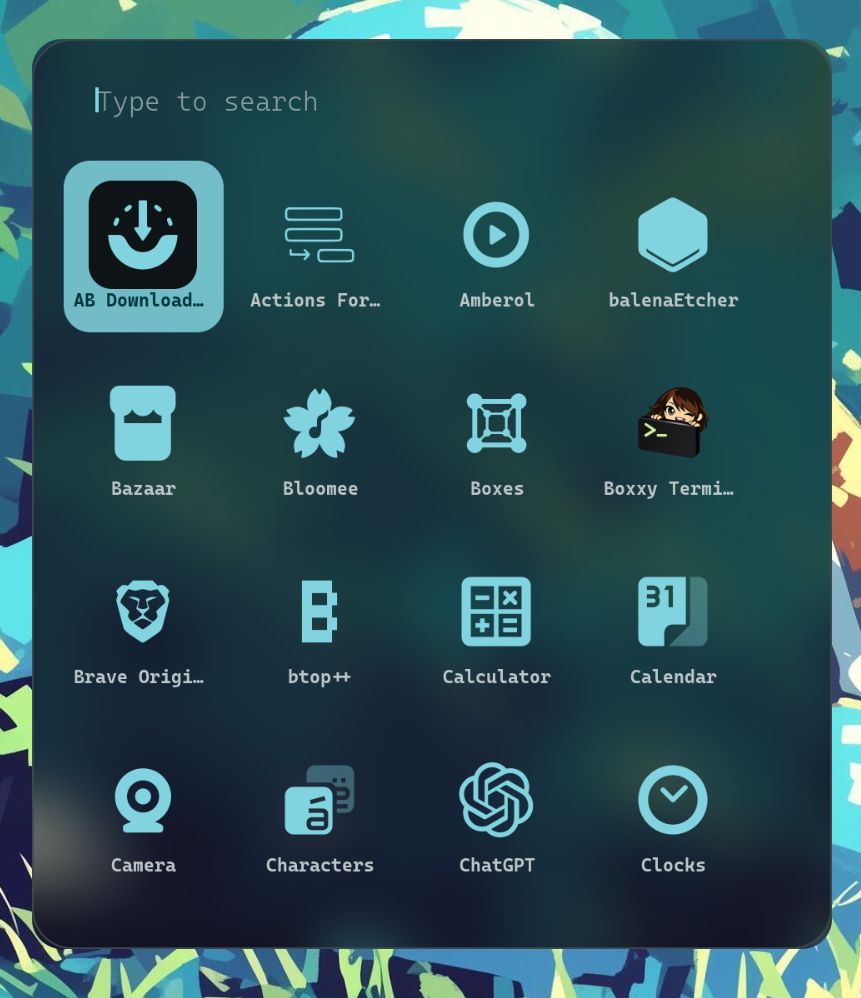<br>`grid` | 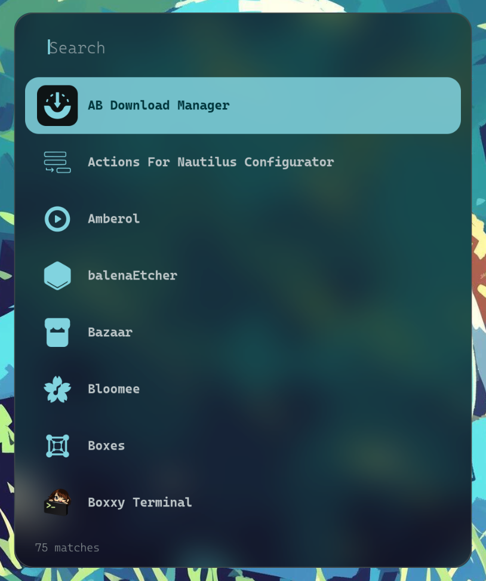<br>`list` | 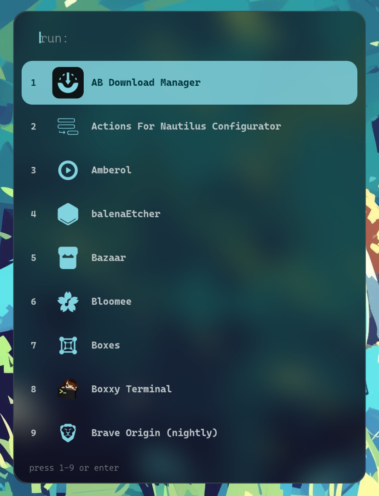<br>`hotkey` |
| 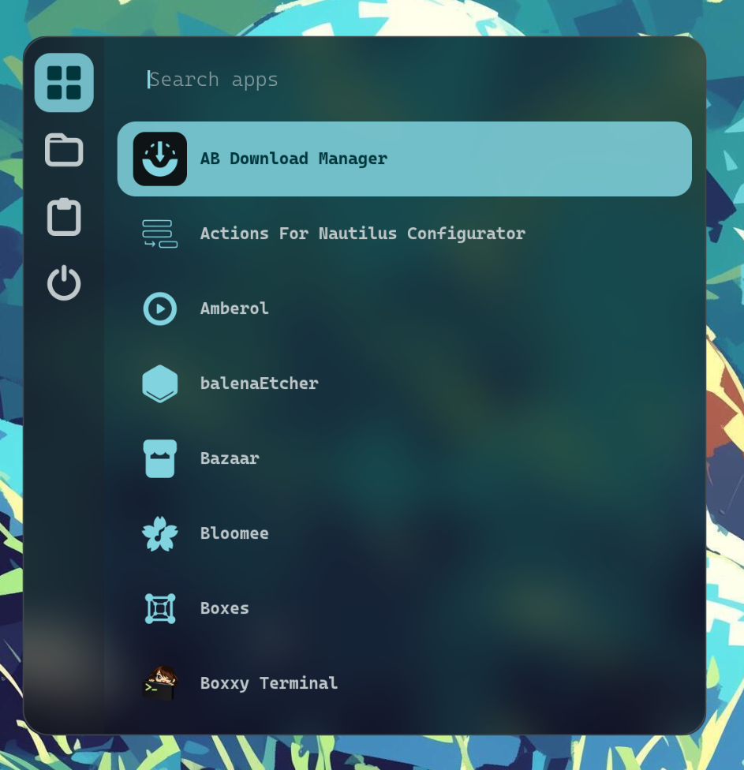<br>`sidebar` | 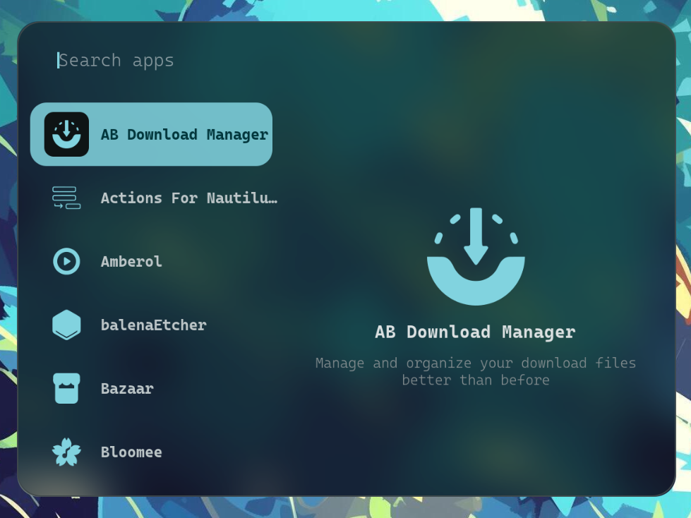<br>`split-preview` | 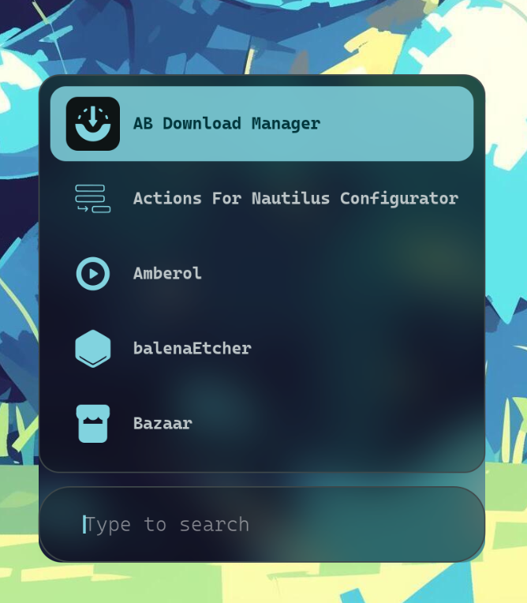<br>`dock` |
| 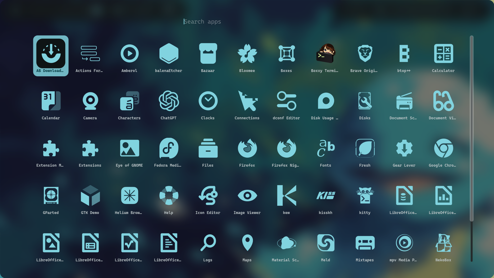<br>`fullscreen` | 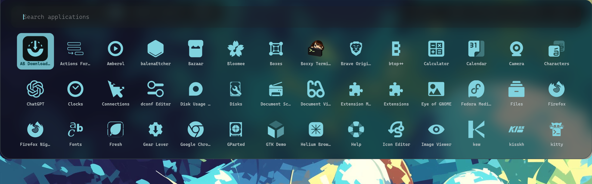<br>`top-dropdown` | 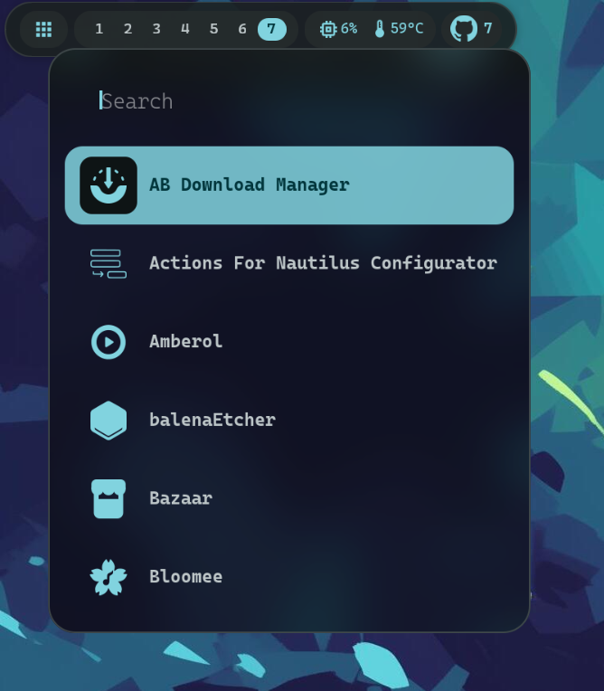<br>`corner` |
| 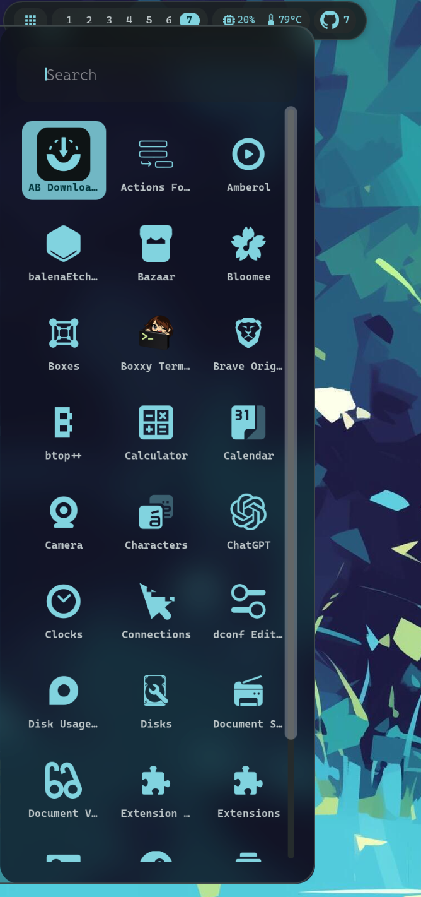<br>`full-edge` | 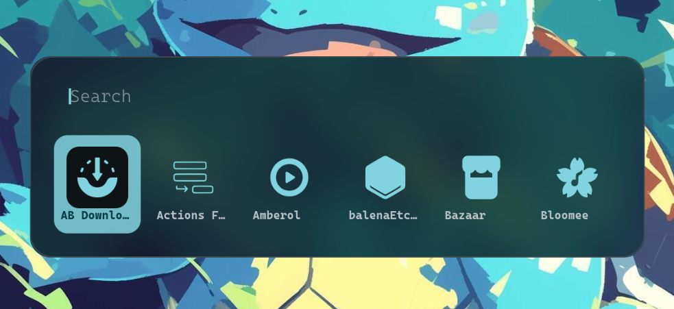<br>`adaptive-width` | 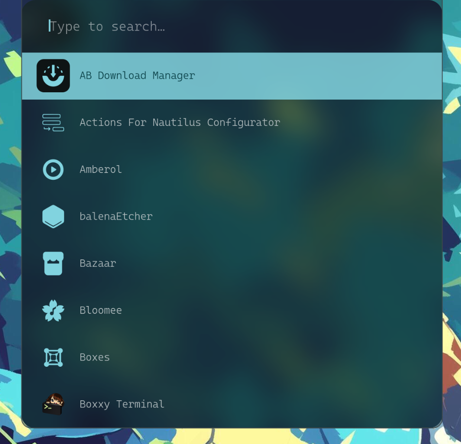<br>`krunner` |
| 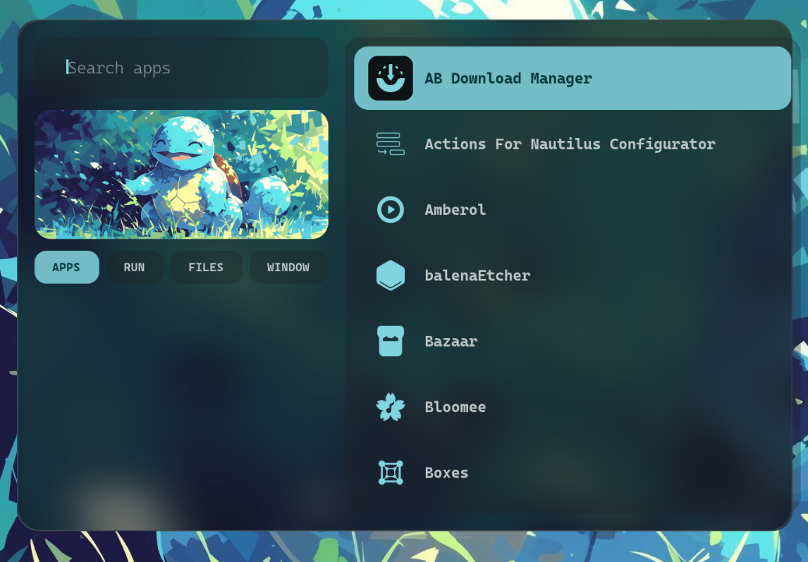<br>`split-tabs` | 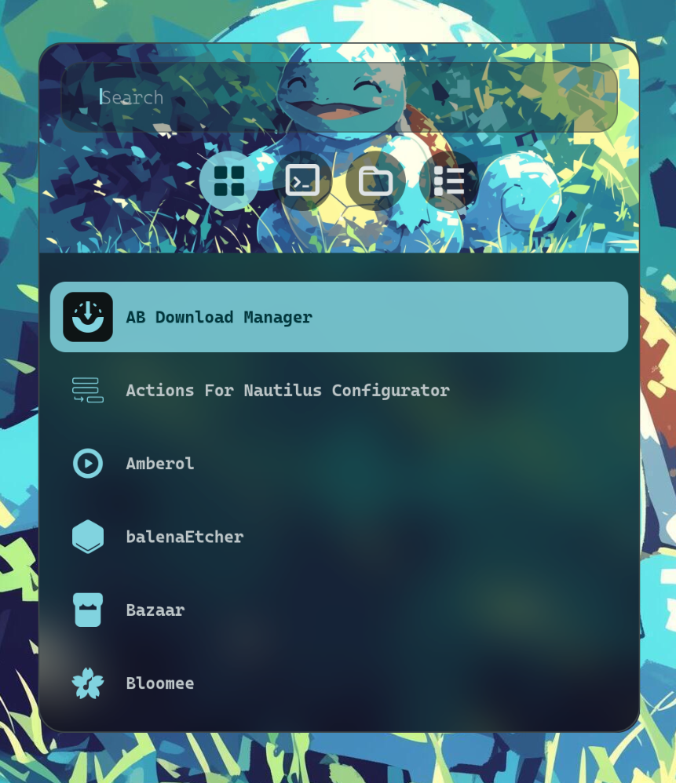<br>`hero-banner` | 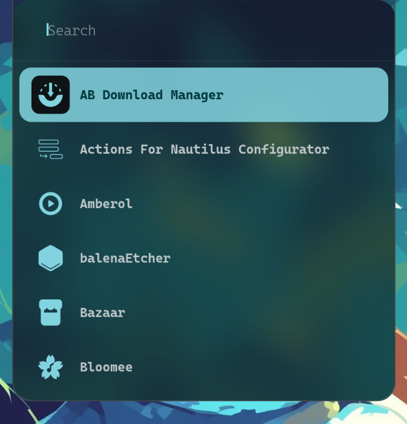<br>`notch` |

## Features

- **15 layouts** to choose from, including grid, list, dock, fullscreen, sidebar, KRunner-style, and notch.
- **Keyboard-first workflow:** open with `Ctrl+Alt+Space`, type to search, navigate with arrow keys, press `Enter` to launch, or `Escape` to close. In Hotkey layout, use `Ctrl+1`–`Ctrl+9` (number row or numeric keypad) to launch the corresponding visible result; plain digits remain searchable.
- **Application search** using GNOME's app-search provider with fuzzy matching as a fallback.
- **Run and window modes** in Sidebar, Split Tabs, and Hero Banner. In Run mode, press `Enter` to launch normally or `Ctrl+Enter` to launch in an available terminal emulator for interactive CLI/TUI programs. Window mode respects the **Search all workspaces** preference. Shell operators and variable expansion are not interpreted.
- **Matugen-compatible theming** using Material 3 color roles from a CSS file.
- **Custom wallpapers** for layouts that display a banner or split panel.
- **Optional clipboard history** with an explicit opt-in setting; collection is off by default. Search and re-copy recent text in Sidebar, Split Tabs, and Hero Banner clipboard mode.
- **Native GNOME Shell overlay** using `ModalDialog`.

## Installation

Clone or download this repository, then run these commands from the project directory:

```bash
glib-compile-schemas schemas/

mkdir -p ~/.local/share/gnome-shell/extensions
ln -s "$(pwd)" ~/.local/share/gnome-shell/extensions/gnome-launcher@sakib.dev
```

Log out and back in so GNOME Shell detects the extension. Then enable it:

```bash
gnome-extensions enable gnome-launcher@sakib.dev
```

The default shortcut is **Ctrl+Alt+Space**. Open the preferences window to choose a layout:

```bash
gnome-extensions prefs gnome-launcher@sakib.dev
```

You can also select a layout from the terminal:

```bash
gsettings --schemadir schemas set org.gnome.shell.extensions.gnome-launcher layout "grid"
```

Available layouts: `list`, `grid`, `hotkey`, `sidebar`, `split-preview`, `dock`, `fullscreen`, `top-dropdown`, `corner`, `full-edge`, `adaptive-width`, `krunner`, `split-tabs`, `hero-banner`, and `notch`.

## Clipboard history

Clipboard history is **off by default**. To enable it, open the extension preferences and turn on **General → Privacy → Clipboard history**. While enabled, the extension polls the text clipboard once per second and keeps up to 20 recent, non-empty text entries **in memory only**; it does not write them to disk. Clipboard contents can include passwords, authentication codes, or private messages, so enable this only if you want the feature. Turning it off stops polling and immediately clears the retained history. Disabling the extension also stops polling and clears the history.

## Theming

In the extension preferences, open **Theming → Theme CSS file** and select a CSS file containing Material 3 color roles, for example:

```css
--surface: #1b1b1f;
--primary: #d0bcff;
```

Or set the path directly:

```bash
gsettings --schemadir schemas set org.gnome.shell.extensions.gnome-launcher theme-file-path "/path/to/colors.css"
```

The file is read whenever the launcher opens. Leave the path empty to use the built-in purple theme.

Layouts with a banner or split panel can also use a custom wallpaper. Set **Wallpaper path** in preferences, or configure the `wallpaper-path` GSettings key. When left empty, the extension first uses GNOME's configured desktop wallpaper, then checks legacy fallback paths.

## Uninstallation

Disable the extension and remove its symlink:

```bash
gnome-extensions disable gnome-launcher@sakib.dev
rm ~/.local/share/gnome-shell/extensions/gnome-launcher@sakib.dev
dconf reset -f /org/gnome/shell/extensions/gnome-launcher/
```

## Development

See [Development notes](docs/development.md) for the project structure and instructions for adding a layout.

## License

GPL-2.0-or-later. See [LICENSE](LICENSE).
