# GNOME Launcher

A customizable, keyboard-first app launcher for GNOME Shell.

Choose from **15 layouts**, search and launch apps, switch between useful finders, pin favorites, and personalize the look with your own colors and wallpapers.

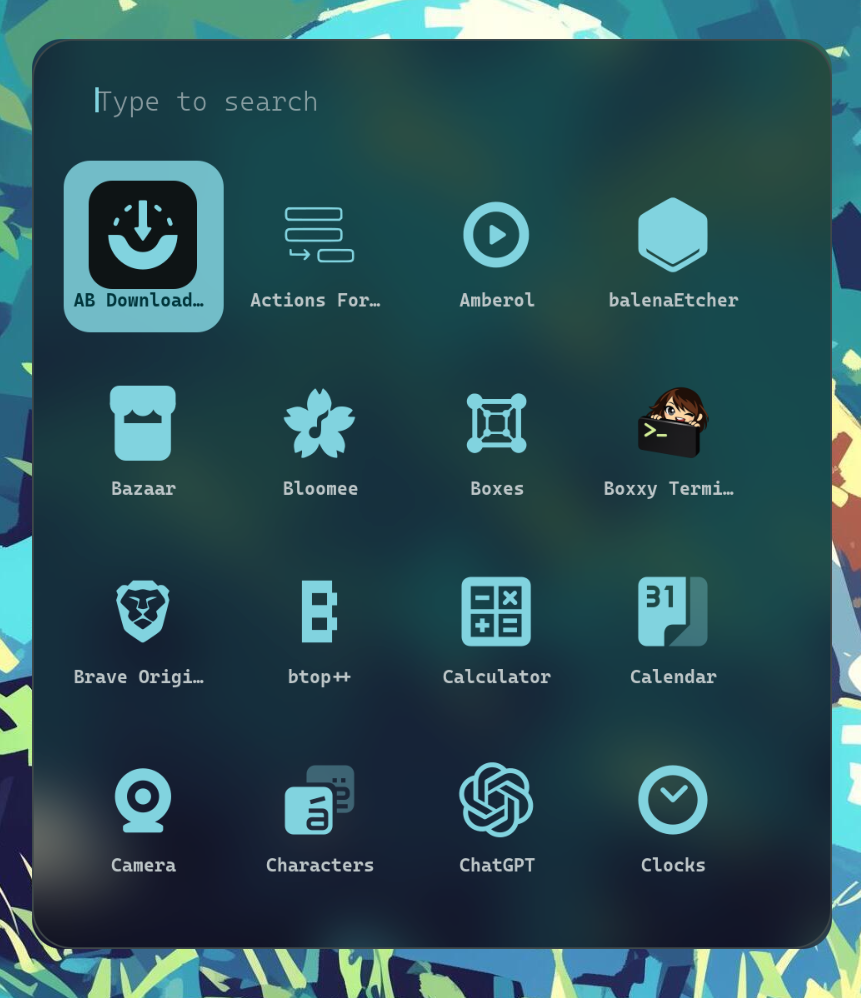

## What you can do

- **Make it yours:** 15 layouts, from a classic grid and list to dock, sidebar, KRunner-style, fullscreen, and notch designs.
- **Find more than apps:** Search files, windows, clipboard history, recent documents, emoji, GNOME Settings, and the web. Calculate expressions or run commands without leaving the launcher.
- **Move fast:** Keyboard navigation, desktop actions, pinned apps, and optional number-key launching.
- **Personalize the look:** Matugen-compatible Material 3 colors, per-layout appearance settings, and custom wallpapers.
- **Stay in control:** Clipboard history is optional and disabled by default.

## Layouts

Pick the layout that fits your workflow in Preferences.

<details>
<summary>Explore all 15 layouts</summary>

| Layout | Preview |
|---|---|
| Grid |  |
| List | 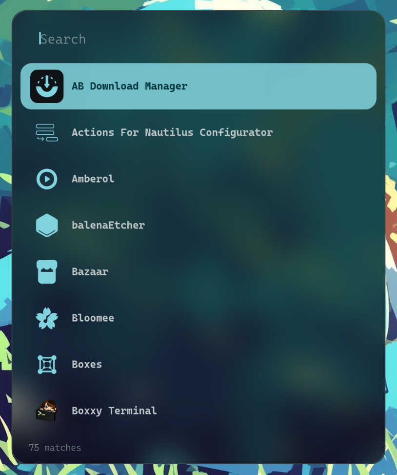 |
| Hotkey | 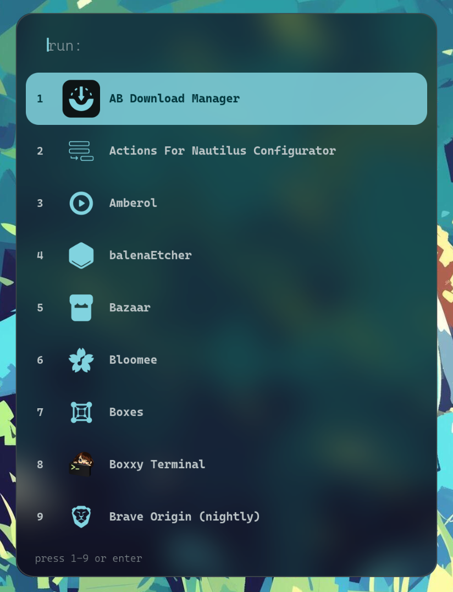 |
| Sidebar | 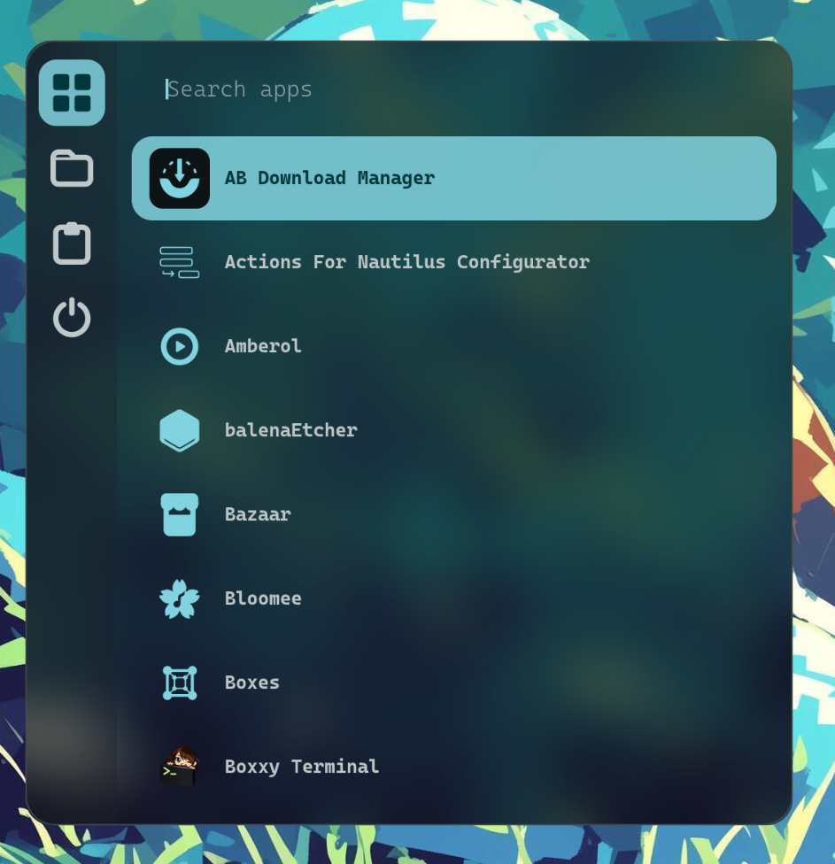 |
| Split Preview | 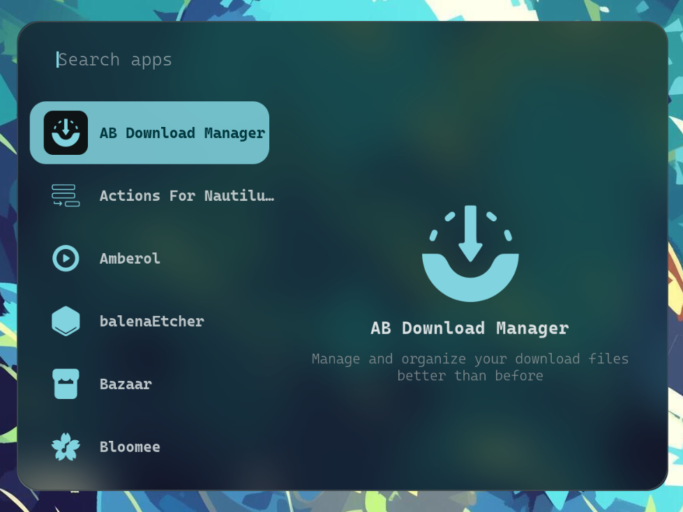 |
| Dock | 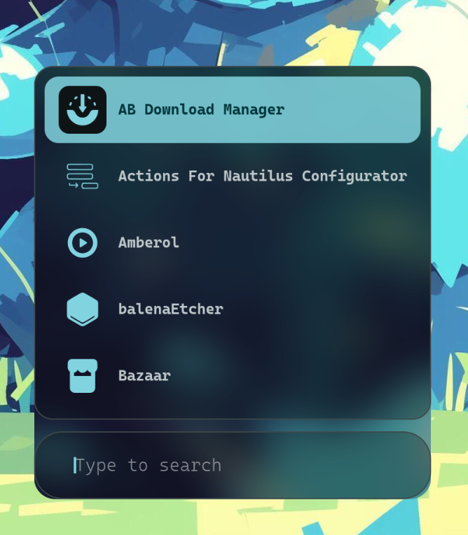 |
| Fullscreen | 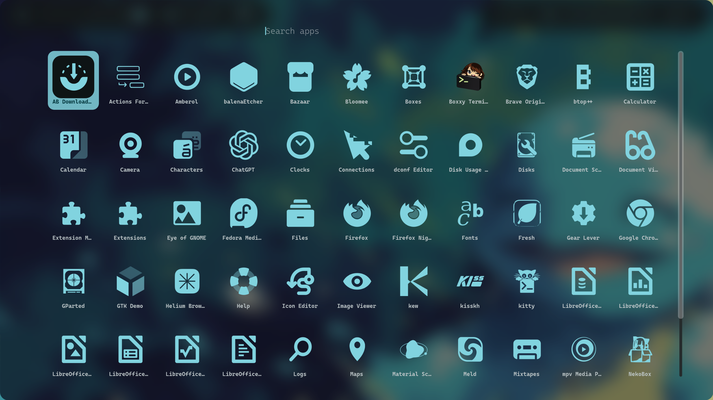 |
| Top Dropdown | 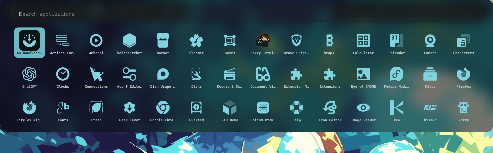 |
| Corner | 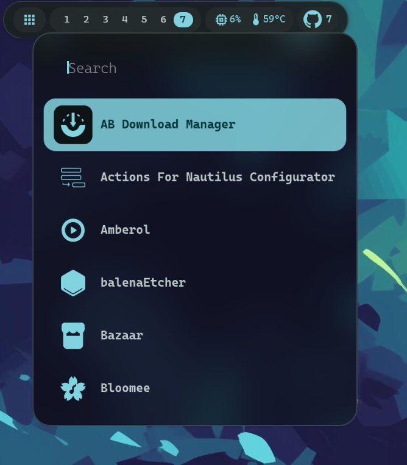 |
| Full Edge | 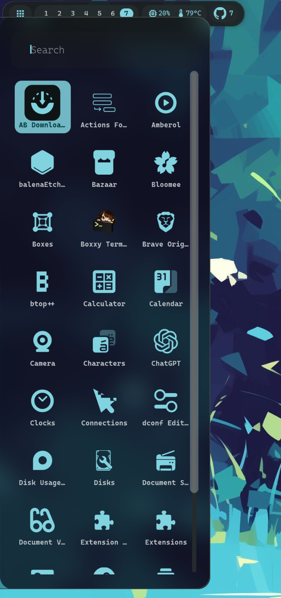 |
| Adaptive Width | 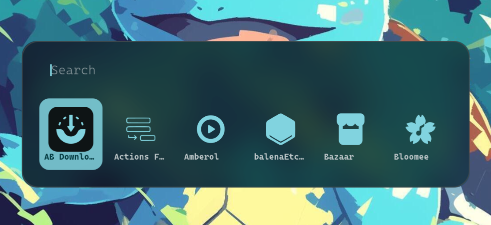 |
| KRunner | 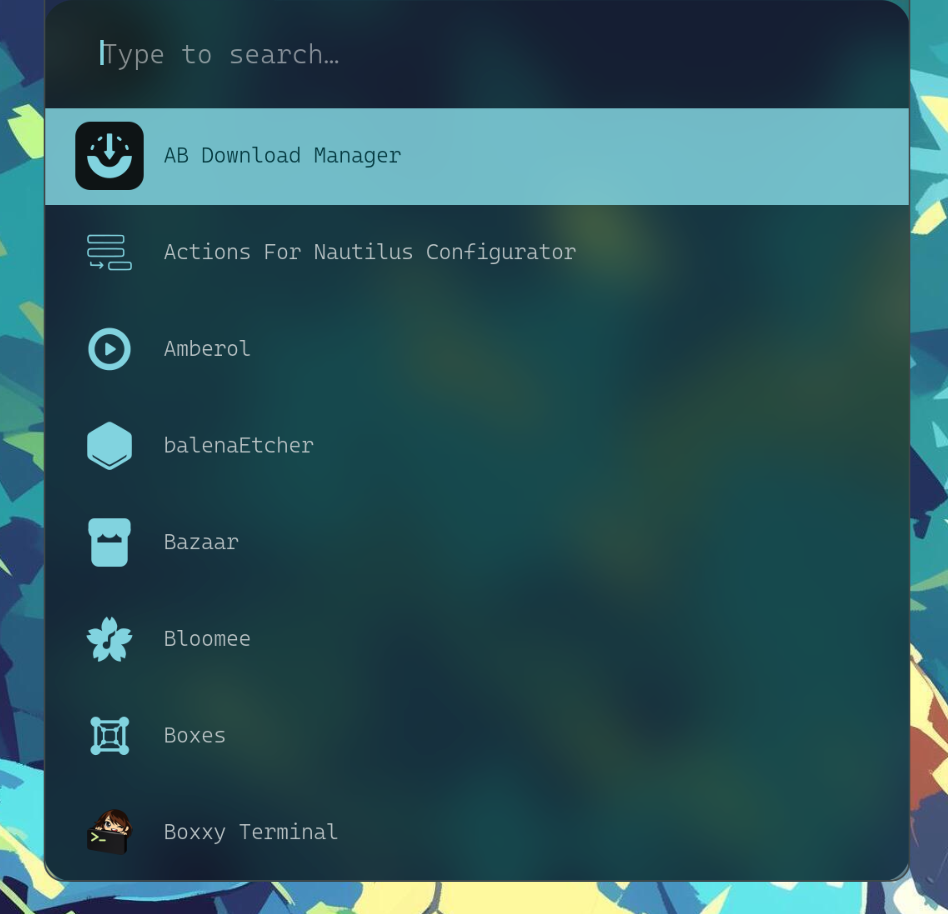 |
| Split Tabs | 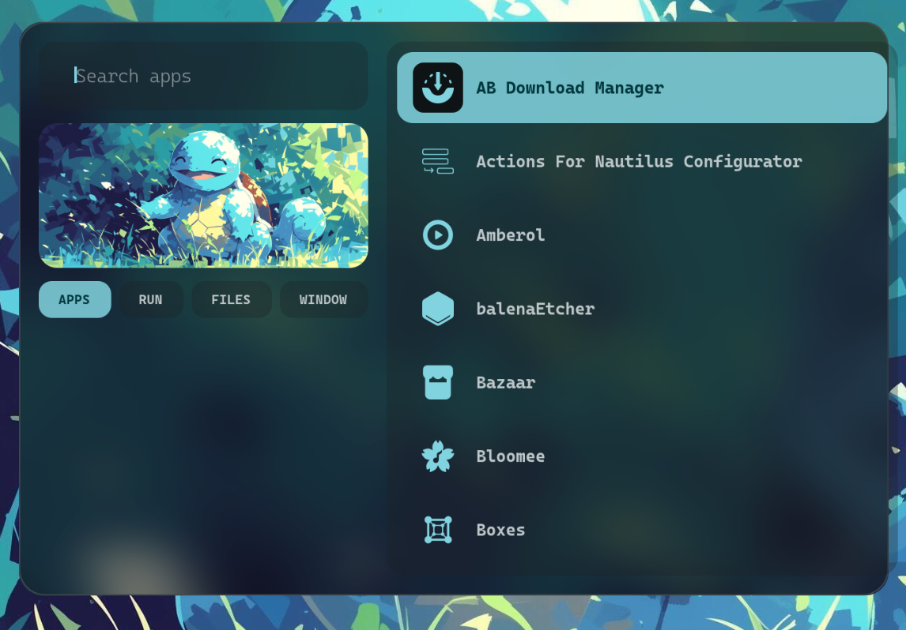 |
| Hero Banner | 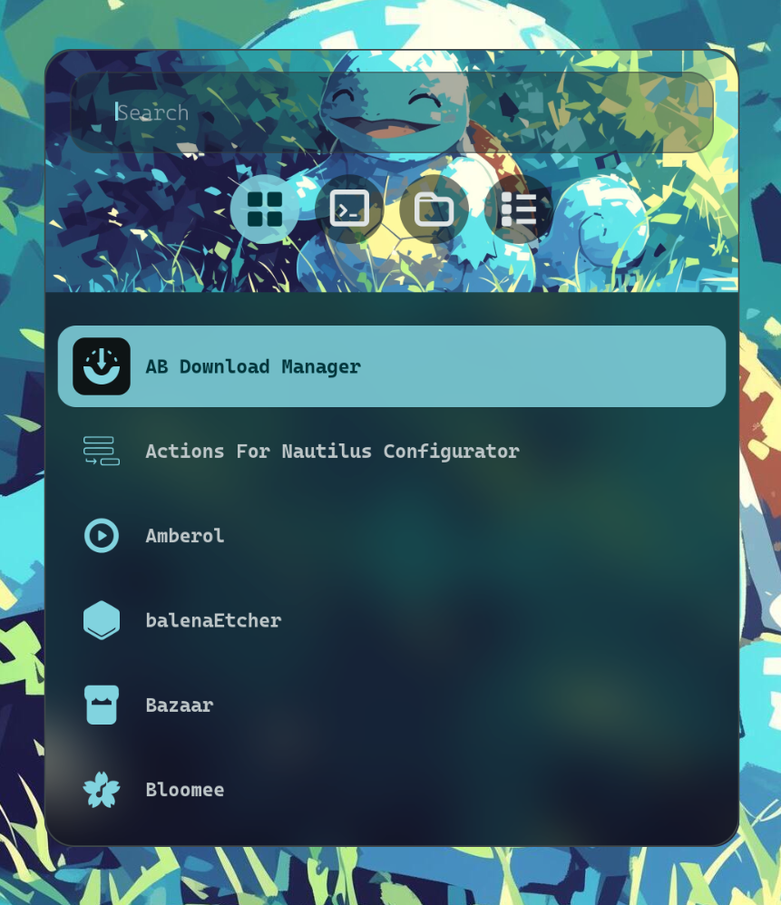 |
| Notch | 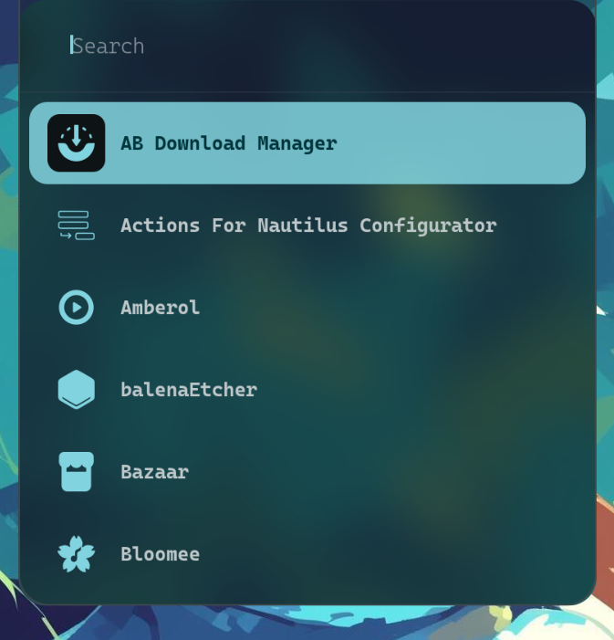 |

</details>

## Install

Install the extension from a local clone:

```bash
git clone https://github.com/SakibShahariar/gnome-launcher.git
cd gnome-launcher
glib-compile-schemas schemas/
mkdir -p ~/.local/share/gnome-shell/extensions
ln -s "$PWD" ~/.local/share/gnome-shell/extensions/gnome-launcher@sakib.dev
gnome-extensions enable gnome-launcher@sakib.dev
```

Log out and back in if GNOME Shell does not detect the extension.

## Get started

- Open the launcher with **Ctrl + Alt + Space**.
- Type to search for an application.
- Use the arrow keys to move, **Enter** to launch, and **Esc** to close.
- Press **Alt + Enter** or right-click a result to open its desktop actions when available.
- Open Preferences to choose a layout, adjust its appearance, and configure finders.

In the Hotkey layout, **Ctrl + 1–9** launches the matching visible result.

## Finders

In Sidebar, Split Tabs, and Hero Banner, use a prefix to search a specific source:

| Prefix | Finder |
|---|---|
| `> command` | Run a command |
| `/ file` | Files |
| `w name` | Open windows |
| `;` | Clipboard history |
| `= expression` | Calculator |
| `? query` | Web search |
| `recent query` | Recent documents |
| `emoji query` | Emoji |
| `s name` or `settings name` | GNOME Settings |

Type `color` to open the screen color picker and copy a color's hex value.

## Personalization

- **Colors:** In Preferences → Theming, select a CSS file with Material 3 color roles. Leave it empty to use the built-in theme.
- **Appearance:** Set global icon size and background opacity, or override them for individual layouts.
- **Wallpaper:** Set a custom wallpaper for layouts with a banner or split panel.

## Privacy

Clipboard history is **off by default**. When enabled, up to 20 recent text and image entries are kept in memory only; they are not written to disk. Clipboard contents may be sensitive, so enable this feature only if you want the launcher to retain them temporarily. Turning it off or disabling the extension clears the history.

## Uninstall

```bash
gnome-extensions disable gnome-launcher@sakib.dev
rm ~/.local/share/gnome-shell/extensions/gnome-launcher@sakib.dev
dconf reset -f /org/gnome/shell/extensions/gnome-launcher/
```

## Development

See the [Development Guide](docs/development.md) for project structure, setup, and contribution notes.

## License

[GPL-2.0-or-later](LICENSE).
